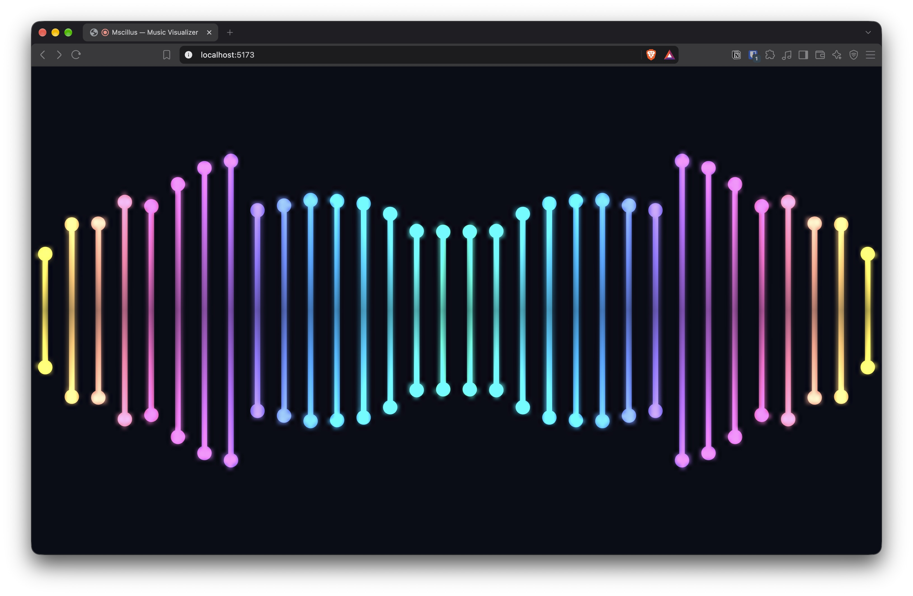
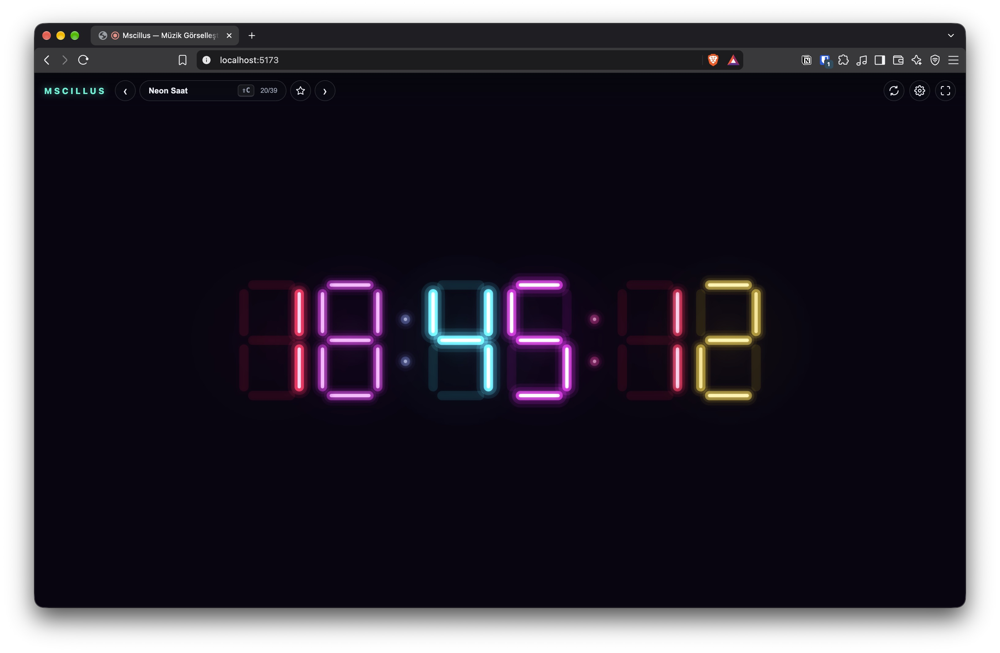
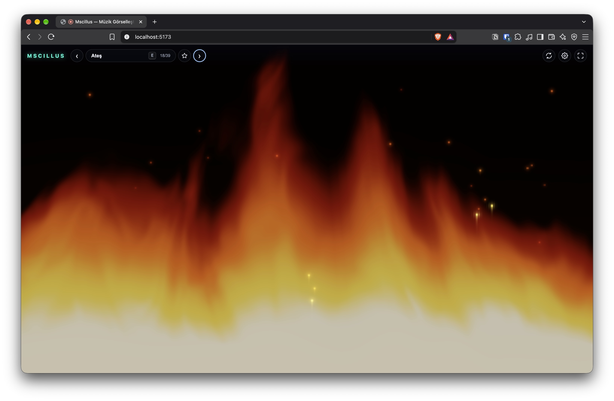
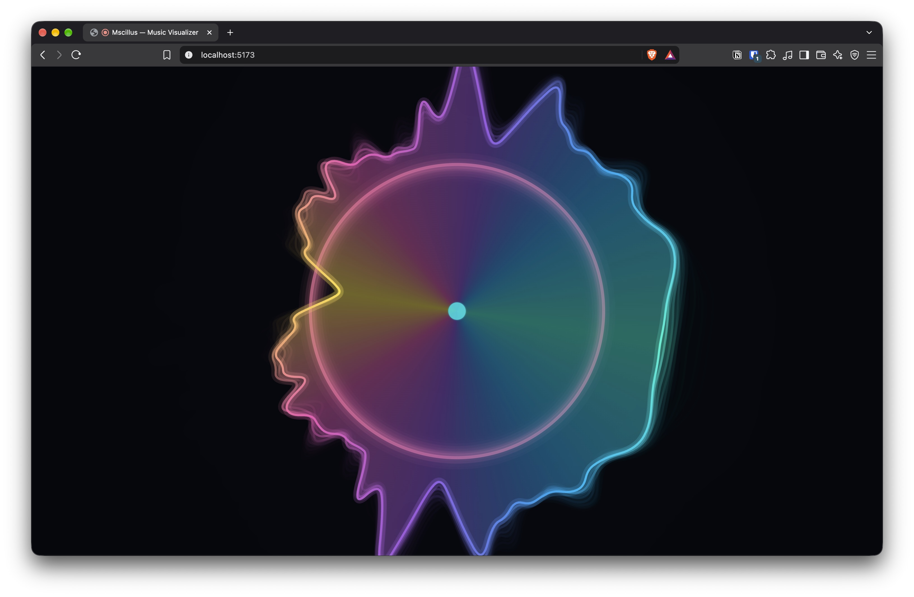
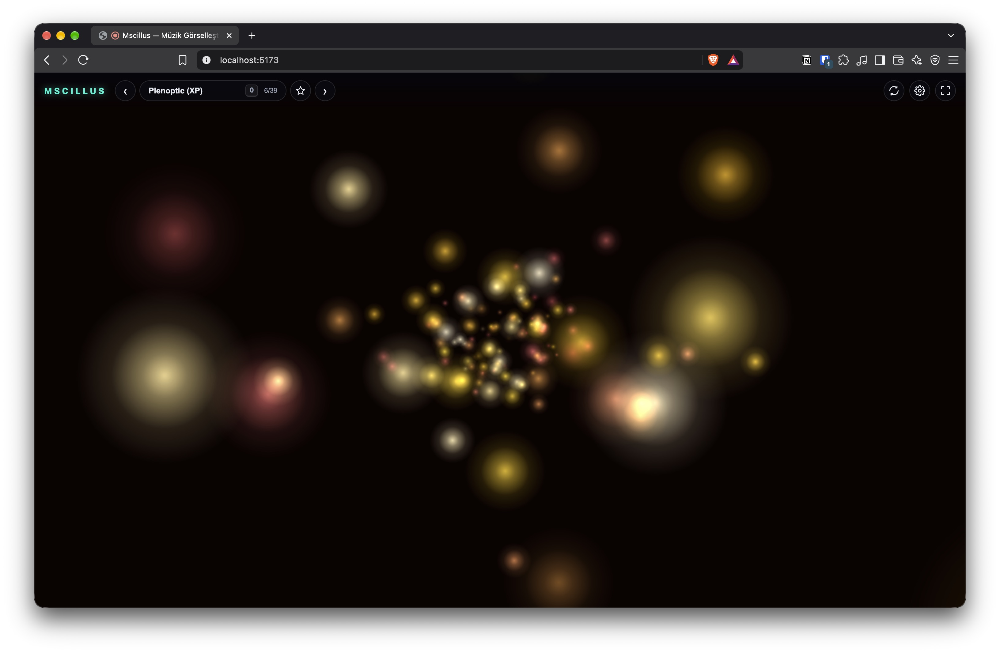
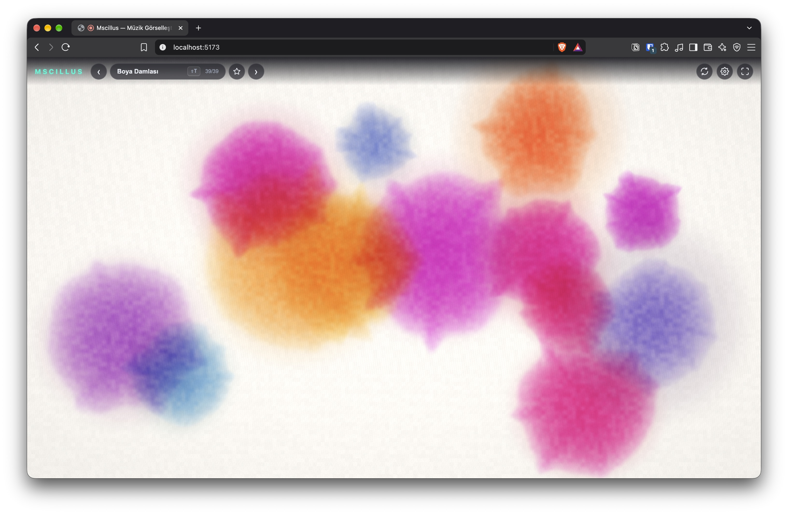
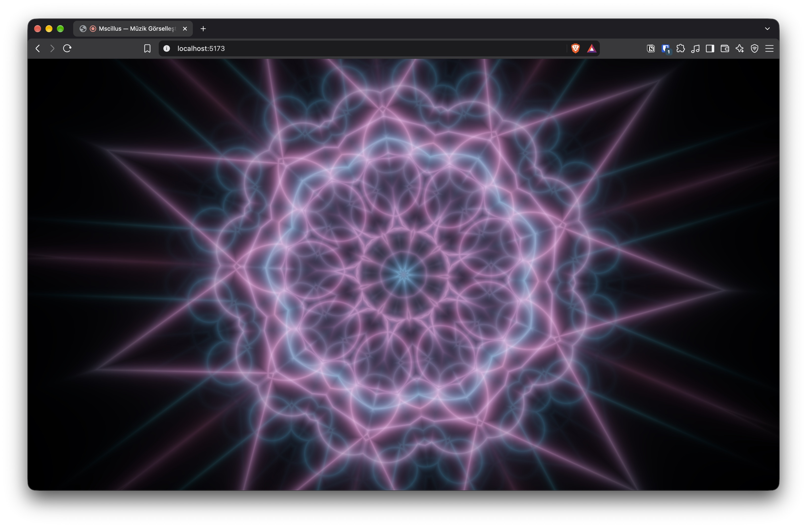

# Mscillus — Music Visualizer

A web app that captures the music playing on your computer in real time and visualizes it from the beat and
frequency data. 39 visual modes, 4 audio sources, in-browser customization, automatic mode switching and a playlist
for local files. The interface is available in **English** and **Turkish** (it opens in your browser's language).



| | | |
|:---:|:---:|:---:|
|  |  |  |
| Neon Clock | Fire | Radial |
|  |  |  |
| Plenoptic (XP) | Paint Drip | Phosphene |

## Getting started

```bash
npm install
npm run dev        # http://localhost:5173
npm run build      # type-check + production build (dist/)
npm run preview    # preview the production build
npm test           # unit tests (Vitest)
```

Chrome or Edge is recommended (best audio-capture support).

## Audio sources

| Source | How | Notes |
|---|---|---|
| **Browser Tab** | Pick the tab in the sharing dialog and tick **"Also share tab audio"** | YouTube, Spotify Web, etc. The most reliable option. |
| **System Audio** | Share "Entire Screen" and tick "Also share system audio" | Works on Windows. On macOS see the BlackHole guide below. |
| **Local File** | Click the card or drop files onto the screen | MP3 / FLAC / WAV / OGG. Several files become a playlist. |
| **Microphone** | Click the card and allow access | Listens to your speakers. Choose the input device in Settings → Audio. |

## Visual modes

Open the mode picker with `/` (search + favorites) or click the mode name in the top bar. Every mode has its own
shortcut key (`⇧` = Shift), and your first 10 favorites also get `1`–`9` and `0`.

- **Spectrum & Wave:** `⇧S` Spectrum Bars · `D` Radial · `V` Waveform · `⇧A` Spectrogram · `⇧V` VU Meters · `⇧W` Note Waterfall
- **Psychedelic:** `A` Ambience · `M` MilkDrop · `G` G-Force · `Z` Chladni Plate · `K` Kaleidoscope · `P` Plasma · `⇧R` Rotozoom · `⇧D` Hypnosis · `⇧K` Op-Art Rings · `⇧B` Metaball · `⇧F` Phosphene · `⇧J` Paper Tear · `⇧T` Paint Drip
- **Space & 3D:** `T` 3D Tunnel · `O` Plenoptic (XP) · `I` Light Speed · `W` Wormhole · `Y` Galaxy · `N` Space Voyage
- **Nature:** `E` Fire · `U` Water Ripples · `Q` Bubbles · `R` Snow · `⇧Y` Rain · `⇧L` Lightning
- **Light & Particles:** `⇧P` Particles · `L` Ribbons · `B` Laser · `C` Fireworks
- **Retro & Stage:** `X` Matrix · `⇧U` Static · `⇧X` Audio Pong · `⇧C` Neon Clock

## Keyboard shortcuts

| Key | Action |
|---|---|
| Mode letters, `1`–`9`, `0` | Switch mode / jump to a favorite |
| `←` / `→` | Previous / next mode |
| `⇧←` / `⇧→` | Previous / next track (file source) |
| `/` | Mode picker |
| `Space` | Play / pause (file source) |
| `S` | Settings panel |
| `H` | Hide / show the interface |
| `F` | Full screen |
| `Esc` | Close the picker / panel |

## Settings

The settings panel (`S`) has four tabs; each one says what it affects.

- **This Mode:** options for the current mode only (each mode remembers its own).
- **Colors:** one palette for all modes — pick a preset or build a custom one (2–6 colors + background). The tab is
  hidden for modes that use their own fixed colors (e.g. Fire's “Fire” and “Blue Flame” styles).
- **Audio:** current source, microphone input device, reaction strength, smoothing and FFT detail.
- **General:** language (Automatic / English / Türkçe), automatic mode switching (interval, favorites or all modes,
  random or sequential, switch on beat), display options, performance (resolution, FPS limit) and reset.

Settings are saved in `localStorage`; the language choice is stored separately and isn't affected by a reset.

## System audio on macOS (BlackHole)

macOS doesn't let apps listen to system audio directly, and Chrome's "Entire Screen + audio" sharing doesn't always
work. If it doesn't:

1. Install [BlackHole 2ch](https://existential.audio/blackhole/).
2. In **Sound settings → Output**, create a Multi-Output Device (built-in speakers + BlackHole 2ch) and select it.
3. In Mscillus choose the **Microphone** source, then pick **BlackHole 2ch** under Settings → Audio → Input Device.
   The choice is remembered; you don't need to change the system input.

## Project layout

- `src/audio/` — Web Audio engine, beat detector, playlist
- `src/visuals/` — the `Visualizer` interface, mode registry and one file per mode (loaded lazily)
- `src/render/` — render loop, automatic resolution scaling, automatic mode switching
- `src/store/` — settings (Context + `localStorage`)
- `src/i18n/` — translations (`en.ts` is the source; add a language by adding a catalog and a `LOCALES` entry)
- `src/ui/` — React components
- `docs/images/` — README screenshots (not part of the app bundle)

More detail and the decision log: [PLAN.md](./PLAN.md) (in Turkish).
